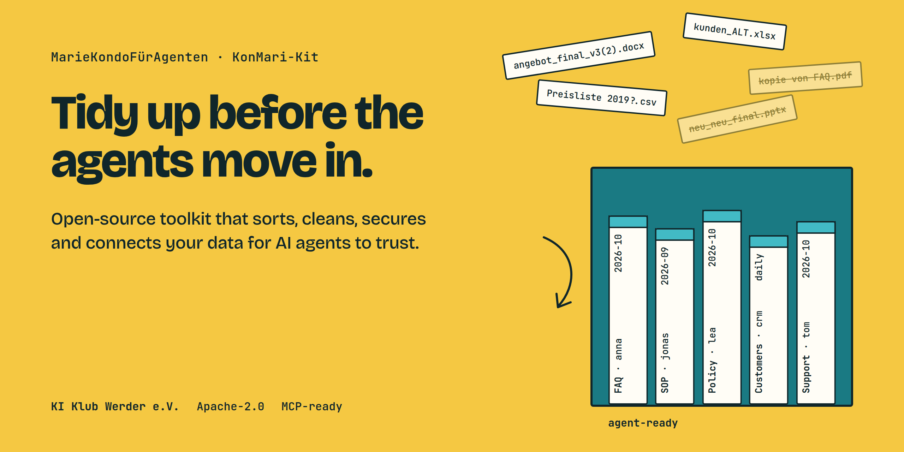

<p align="center"></p>

<p align="center">
  <a href="https://github.com/KI-Klub-Werder-e-V/MarieKondoFuerAgenten/actions/workflows/ci.yml"></a>
  <a href="https://github.com/KI-Klub-Werder-e-V/MarieKondoFuerAgenten/releases"></a>
  <a href="LICENSE"></a>
  
  <a href="#quick-start-with-claude-code"></a>
  
</p>

# MarieKondo&shy;FürAgenten

**Make your organisation's data agent-ready, the KonMari way.**

English · [Deutsch](README.de.md)

Point an AI agent at a SharePoint, a CRM and a file share and it finds
`angebot_final_v3(2).docx`, three price lists from three years and a customer table nobody has
touched since 2021. Then it answers confidently and wrongly.

The KonMari-Kit fixes the data, not the prompt. It takes one use case, discards what doesn't
belong, sorts the rest by category, gives every item an owner, a definition and the right
permissions, and serves the result to your agents through a read-only MCP server. Every step is
gated, every decision is made by a named person and logged, and every change can be undone.

## Quick start with Claude Code

```
/plugin marketplace add KI-Klub-Werder-e-V/MarieKondoFuerAgenten
/plugin install konmari@konmari-kit
```

Open Claude Code in an empty folder and say what you need:

> Tidy our data for an FAQ agent in the club office.

Claude interviews you for the charter, registers your sources, runs the scans and checks, and
explains each report. It stops before every approval and asks the person the charter names.
Requires Python 3.12 and [uv](https://docs.astral.sh/uv/). Details: [`docs/agents.md`](docs/agents.md).

<details>
<summary><b>Command line only</b></summary>

```bash
git clone https://github.com/KI-Klub-Werder-e-V/MarieKondoFuerAgenten
cd MarieKondoFuerAgenten && uv sync
cd examples/verein-faq-assistant          # fictional sports club, FAQ assistant

uv run konmari next                       # where are we, what's next
uv run konmari charter validate
uv run konmari charter approve --as anna
uv run konmari metrics validate
uv run konmari metrics approve --as ben
uv run konmari charter gate --step inventory
```

The gate refuses until every must-have metric has a baseline:

```
unmet: metrics: must_have metric 'answer_accuracy' has no baseline or measurement plan
```

Continue with the [guide](docs/guide.en.md). All commands: [`docs/cli.md`](docs/cli.md).

</details>

## How it works

Nine steps for one use case. Each step checks that the previous one is done.

| # | Step | Commands | What happens |
|---|---|---|---|
| 1 | Commit | `charter` `metrics` | Use case, roles, GDPR/AI Act screening, success metrics with baselines |
| 2 | Gather by category | `inventory` `categories` | Sources across systems, grouped by category instead of location, ordered by risk |
| 3 | Spark joy? | `score` `review` | Six-question test per asset, proposal keep / fix / discard |
| 4 | Discard first | `discard` `retention` | Duplicates, superseded versions, off-scope items to a reversible archive |
| 5 | One truth | `normalize` `resolve` `policy` `conflicts` | Dates, IDs and names normalised, entities matched, a leading source per field |
| 6 | Fold | `chunk` `enrich` `glossary` | Structure-aware chunks, metadata on every chunk, approved business glossary |
| 7 | Secure | `govern` `audit` | Source permissions carried into the index, PII masked, hash-chained audit trail |
| 8 | Connect | `product` `serve` | Versioned data products and a read-only MCP server |
| 9 | Check | `eval` `monitor` | Golden questions with citations and abstention, freshness and drift alerts |

Low-risk categories go first (public FAQ), special-category personal data last.

## The joy test

Every asset is scored 0–3 on six criteria, with evidence:

| Criterion | Checked against |
|---|---|
| Authoritative and current | last change vs. agreed update frequency, superseded versions |
| Owned | a named owner who maintains it |
| Meaning clear | columns and terms defined in the glossary |
| Retrievable | well-cut passages, clean table schemas |
| Conflicts resolved | a rule for which source wins |
| Permissions explicit | source ACLs present and propagated |

| | Before | After |
|---|---|---|
| Format | whole documents, raw tables | chunked passages, versioned data products |
| Metadata | file name | source, date, owner, freshness, definitions |
| Access | whatever the service account sees | read scopes per agent, source permissions kept |
| Consistency | duplicates, three versions of the truth | deduplicated, one leading source per field |
| Freshness | manual, forgotten | scheduled refresh with change tracking |
| Discoverability | buried in silos | catalogued and callable via MCP |

## Features

- **Deterministic engine.** Gates, scoring, deduplication and policies are rules with versioned
  thresholds. Same inputs, same result. Models are optional and pinned.
- **Humans approve.** Discarding, masking, erasing and publishing need sign-off from the role the
  charter names, recorded with identity and time.
- **Reversible and auditable.** Archive instead of delete, restore by command, a hash-chained audit
  trail you can verify with `konmari audit verify`.
- **Duplicates at three levels.** Identical files, near-duplicates (MinHash/LSH), semantic
  duplicates (embeddings, optional).
- **GDPR built in.** Local PII detection (Presidio, spaCy), retention rules and legal holds per
  category, keyed pseudonymisation, record of processing activities export.
- **Open standards.** DCAT inventory, OpenLineage lineage, ODPS/ODCS data products, SKOS glossary,
  MCP for agents.
- **Self-hosted.** DuckDB locally, Postgres 16 in production. No cloud service required.

## Documentation

| | |
|---|---|
| Step-by-step guide | [`docs/guide.en.md`](docs/guide.en.md) and one `*-guide.en.md` per step |
| Command reference | [`docs/cli.md`](docs/cli.md) |
| Claude Code skill | [`docs/agents.md`](docs/agents.md), [`skills/konmari/`](skills/konmari/) |
| Specs and roadmap | [`openspec/ROADMAP.md`](openspec/ROADMAP.md), [`openspec/changes/`](openspec/changes/) |
| Research with sources | [`research/`](research/) |

## Contributing

The most useful contribution is a **[pilot report](https://github.com/KI-Klub-Werder-e-V/MarieKondoFuerAgenten/issues/new?template=pilot.yml)**:
which use case, which systems, how far you got and where it got stuck. Connectors (Nextcloud,
Confluence, Google Drive, more CRMs), examples and translations are welcome too.

```bash
uv sync && uv run pytest -q
openspec validate --all --strict
```

Behaviour changes start as an [OpenSpec](https://github.com/Fission-AI/OpenSpec) change. See
[`CONTRIBUTING.md`](CONTRIBUTING.md) and [`AGENTS.md`](AGENTS.md).

## License

[Apache-2.0](LICENSE). A project of [KI Klub Werder e. V.](https://ki-klub-werder.de)
