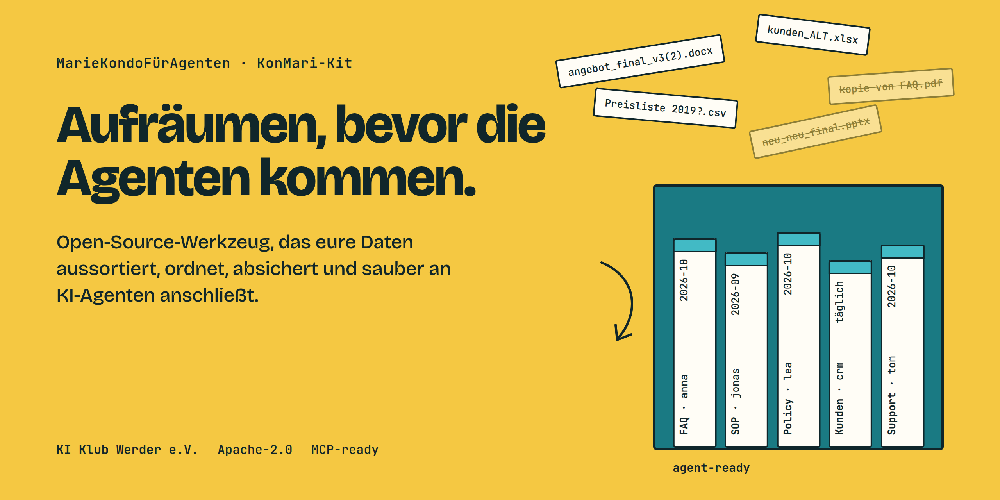

<p align="center"></p>

<p align="center">
  <a href="https://github.com/KI-Klub-Werder-e-V/MarieKondoFuerAgenten/actions/workflows/ci.yml"></a>
  <a href="LICENSE"></a>
  
  
  
</p>

# MarieKondo&shy;FürAgenten

**Euer Agent ist nur so gut wie die Ablage, aus der er liest.**

Deutsch · [English](README.en.md)

Ein KI-Agent, der auf euer SharePoint, euer CRM und eure Netzlaufwerke losgelassen wird, findet
dort `angebot_final_v3(2).docx`, drei Preislisten aus drei Jahren und eine Kundentabelle, die
zuletzt 2021 jemand gepflegt hat. Dann antwortet er überzeugt und falsch. Das liegt selten am
Modell, sondern meist an den Daten.

Das **KonMari-Kit** räumt genau das auf, mit der Methode von Marie Kondo, übersetzt für
Daten: erst entscheiden, wofür aufgeräumt wird, dann aussortieren, nach Kategorie ordnen,
jedem Teil einen Platz und eine verantwortliche Person geben und erst danach anschließen.
Am Ende steht ein MCP-Server, über den eure Agenten nur noch aktuelle, freigegebene, gut
beschriebene Daten sehen, und der „Ich weiß es nicht“ sagen darf, statt zu raten.

Ein Projekt des [KI Klub Werder e. V.](https://github.com/KI-Klub-Werder-e-V), Apache-2.0.

## Macht es eurem Agenten Freude?

Jede Datei, jede Tabelle und jede Quelle muss durch denselben Test. Sechs Fragen, jede mit
0 bis 3 Punkten bewertet, mit Belegen:

| Frage | Was das Kit prüft |
|---|---|
| Ist es maßgeblich und aktuell? | Änderungsdatum gegen die vereinbarte Aktualisierungsfrequenz, überholte Fassungen |
| Gehört es jemandem? | eine benannte verantwortliche Person, die es pflegt |
| Ist die Bedeutung klar? | Spalten und Begriffe stehen im Glossar, nicht nur `kd_st_2` |
| Findet ein Agent den richtigen Ausschnitt? | sinnvoll geschnittene Textabschnitte, saubere Tabellenschemata |
| Sind Widersprüche geklärt? | Regel, welche Quelle bei Konflikten gewinnt |
| Sind die Rechte klar? | Berechtigungen der Quelle reisen mit den Daten bis in den Index |

Das Ergebnis ist ein Vorschlag **behalten**, **reparieren** oder **aussortieren**. Den
Vorschlag bestätigt immer ein Mensch, und jede Entscheidung lässt sich rückgängig machen.

## Vorher und nachher

| | Vorher | Mit dem KonMari-Kit |
|---|---|---|
| Format | ganze Dokumente, rohe Tabellen | geschnittene Abschnitte, versionierte Datenprodukte |
| Metadaten | Dateiname | Quelle, Datum, Typ, verantwortliche Person, Aktualität, Definitionen |
| Zugriff | alles, was das Dienstkonto sieht | Leserechte je Agent, Rechte der Quelle bleiben erhalten |
| Widersprüche | Dubletten und drei Wahrheiten | entdoppelt, eine führende Quelle je Feld |
| Aktualität | „hat das mal jemand aktualisiert?“ | geplante Aktualisierung mit Änderungsverfolgung |
| Auffindbarkeit | in Silos vergraben | im Katalog beschrieben und per MCP abrufbar |

## So räumt ihr auf

Neun Schritte, immer für **einen** Anwendungsfall, zum Beispiel einen FAQ-Assistenten für
die Geschäftsstelle. Jeder Schritt prüft, ob der vorige sauber abgeschlossen ist. Das Kit
lässt euch also nicht anreichern, was ihr noch nicht aussortiert habt.

```
 1  charter      Wofür räumen wir auf? Anwendungsfall, Rollen, Datenschutz, Erfolgskennzahlen
 2  inventory    Was liegt wo? Quellen über alle Systeme, sortiert nach Kategorie statt Ablageort
 3  score        Macht es Freude? Sechs Fragen, Vorschlag behalten / reparieren / aussortieren
 4  discard      Danke und tschüss: Dubletten, alte Fassungen, Irrelevantes ins Archiv
 5  normalize    Eine Wahrheit: Datumsangaben, IDs und Namen vereinheitlichen, führende Quelle festlegen
 6  chunk/enrich Ordnen: Abschnitte schneiden, Metadaten anheften, Glossar pflegen
 7  govern       Absichern: Rechte, Maskierung personenbezogener Daten, manipulationssicheres Protokoll
 8  product/serve Anschließen: Datenprodukte und ein MCP-Server nur zum Lesen
 9  eval/monitor Prüfen: echte Fragen, Belege, Abstinenz, Aktualität laufend überwachen
```

Die Reihenfolge der Kategorien folgt dem Risiko: erst die öffentliche FAQ, dann die Verträge,
ganz zum Schluss alles mit besonders schützenswerten Daten nach Art. 9 DSGVO.

## Schnellstart

Voraussetzungen: Python 3.12 und [uv](https://docs.astral.sh/uv/). Das Beispiel ist ein
erfundener Sportverein mit einem FAQ-Assistenten für die Geschäftsstelle.

```bash
git clone https://github.com/KI-Klub-Werder-e-V/MarieKondoFuerAgenten
cd MarieKondoFuerAgenten && uv sync
cd examples/verein-faq-assistant

uv run konmari charter validate          # Charta prüfen: Rollen, Datenschutz, Datenumfang
uv run konmari charter approve --as anna # die verantwortliche Person gibt frei
uv run konmari metrics validate          # Erfolgskennzahlen und Fragenkatalog prüfen
uv run konmari metrics approve --as ben
uv run konmari charter gate --step inventory
```

Das letzte Kommando scheitert, und das ist Absicht:

```
unmet: metrics: must_have metric 'answer_accuracy' has no baseline or measurement plan
```

Ohne Ausgangswert gibt es keinen Aufräumbeginn, denn sonst weiß hinterher niemand, ob es
etwas gebracht hat. Wie es weitergeht, steht Schritt für Schritt in der
[Anleitung](docs/guide.de.md). Alle Befehle auf einen Blick: [`docs/cli.de.md`](docs/cli.de.md).

## Was drinsteckt

- **Ein Katalog für alle Entscheidungen.** DuckDB lokal, Postgres 16 im Betrieb, dieselben
  Migrationen. Jede Entscheidung mit Person, Rolle, Zeitpunkt und Begründung.
- **Menschen entscheiden, das Kit schlägt vor.** Aussortieren, Maskieren, Löschen und
  Veröffentlichen brauchen eine Freigabe der zuständigen Rolle aus der Charta.
- **Alles umkehrbar, alles protokolliert.** Archiv statt Papierkorb, Wiederherstellen per
  Befehl, ein hash-verkettetes Prüfprotokoll (`konmari audit verify`).
- **Dubletten auf drei Ebenen:** identische Dateien, fast gleiche Texte (MinHash) und
  inhaltlich gleiche Texte (Embeddings, optional).
- **Datenschutz eingebaut.** Personendaten werden lokal mit Presidio und spaCy erkannt,
  Löschfristen und Aufbewahrungspflichten je Kategorie, Pseudonymisierung mit Schlüssel statt
  Rückübersetzungstabelle, Verzeichnis der Verarbeitungstätigkeiten als Export.
- **Offene Standards statt Eigenbau:** DCAT für das Inventar, OpenLineage für die Herkunft,
  ODPS und ODCS für Datenprodukte, SKOS für das Glossar, MCP für Agenten.
- **Selbst gehostet, ohne Pflicht-Cloud.** Modelle für Embeddings und Bewertung laufen lokal;
  eine gehostete API ist per Konfiguration möglich.

## Für wen ist es gedacht?

- Vereine, Verbände, kleine und mittlere Unternehmen und Verwaltungen, die einen ersten
  Agenten auf ihre eigenen Daten loslassen wollen
- Freiwillige, IT-Verantwortliche und Berater:innen, die so ein Projekt begleiten
- alle, die vorher wissen wollen, welche Daten der Agent sieht, und das belegen müssen

Gearbeitet wird auf der Kommandozeile. Für die Freigaben braucht es keine Programmierkenntnisse,
aber jemanden, der die Befehle ausführt.

## Ausprobieren und Erfahrungen teilen

Nehmt euch einen kleinen Anwendungsfall und eine Kopie eurer Daten, und los geht's. Gebaut wurde
das Kit spezifikationsgetrieben mit [OpenSpec](https://github.com/Fission-AI/OpenSpec): neun
Schritte, jeder mit Anforderungen, Tests und Recherche samt Quellen in [`research/`](research/).

Was bei euch geklappt hat und wo es geklemmt hat, gehört ins Repo:
**[Pilot-Bericht schreiben](https://github.com/KI-Klub-Werder-e-V/MarieKondoFuerAgenten/issues/new?template=pilot.yml)**. Aus diesen Berichten kalibrieren wir Schwellenwerte, Beispiele
und Anleitungen für alle.

## Mitmachen

Gesucht sind vor allem Pilot-Erfahrungen. Wenn ihr das Kit an einem echten Anwendungsfall
ausprobiert, schreibt uns, was geklemmt hat. Außerdem willkommen: weitere Konnektoren (Nextcloud,
Confluence, Google Drive, weitere CRMs), bessere deutsche Beispiele und Übersetzungen.
Fehler und Ideen bitte als [Issue](https://github.com/KI-Klub-Werder-e-V/MarieKondoFuerAgenten/issues).

```bash
uv sync && uv run pytest -q              # Tests; Postgres-Tests nutzen KONMARI_TEST_PG_URL oder ein lokales Postgres 16
openspec validate --all --strict         # Specs prüfen
```

Neue Funktionen beginnen als OpenSpec-Change. Wie das geht und welche Regeln für Menschen und
Agenten gelten, steht in [`CONTRIBUTING.md`](CONTRIBUTING.md) und [`AGENTS.md`](AGENTS.md).
Echte personenbezogene Daten gehören nie ins Repository.

## Dokumentation

| Thema | Wo |
|---|---|
| Anleitung Schritt für Schritt | [`docs/guide.de.md`](docs/guide.de.md) und die `*-guide.de.md` je Schritt |
| Alle Befehle | [`docs/cli.de.md`](docs/cli.de.md) |
| Roadmap, Abdeckung, gemeinsames Vokabular | [`openspec/ROADMAP.md`](openspec/ROADMAP.md) |
| Anforderungen und Entwurf je Schritt | [`openspec/changes/`](openspec/changes/) |
| Recherche mit Quellen | [`research/`](research/) |
| Schnittstellen zwischen den Schritten | [`docs/*-contract.md`](docs/) |

## Lizenz

Apache-2.0, siehe [`LICENSE`](LICENSE).
